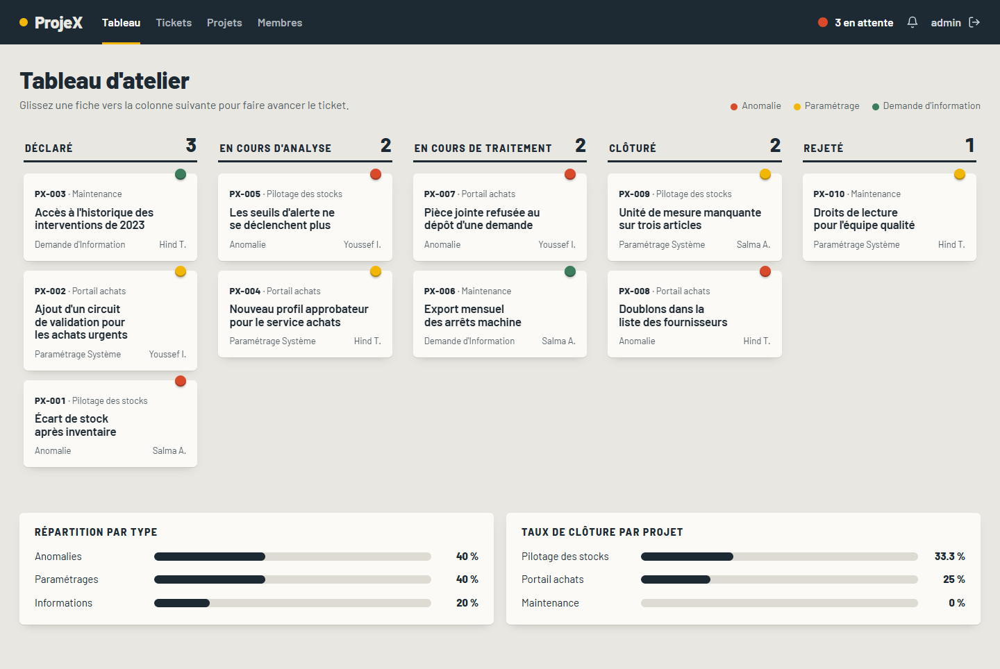
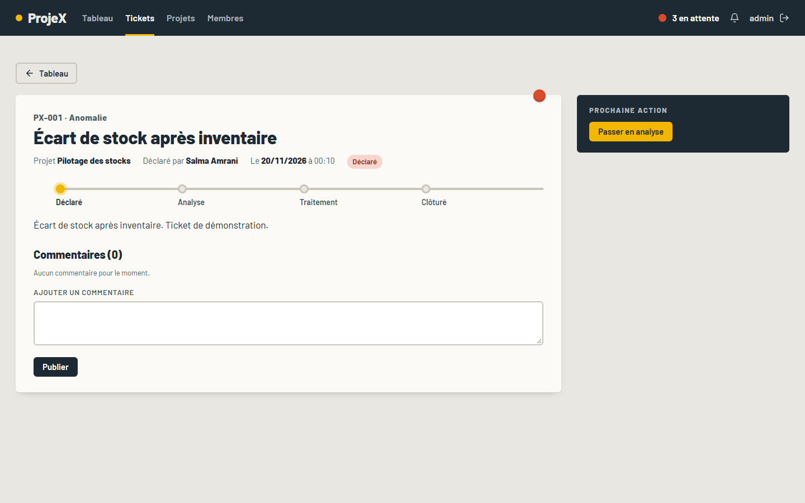
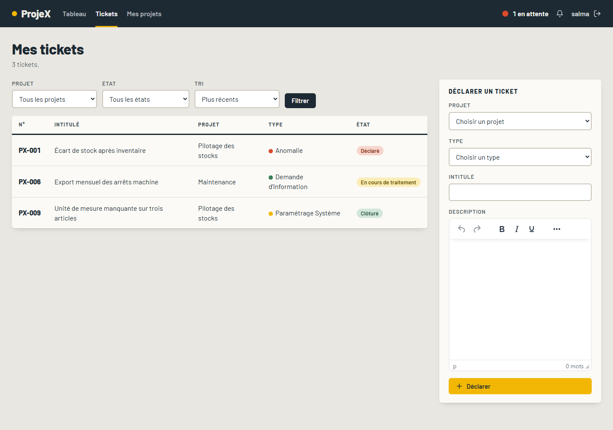

# ProjeX : suivi des tickets d'une équipe SI

Application web Django que j'ai développée en juillet-août 2024, pendant un stage de six semaines à la Digital Factory de Cosumar (Casablanca). L'équipe, six personnes, s'en est servie pour déclarer, répartir et suivre les tickets de ses projets internes. Le cahier des charges a été précisé au fil de prototypes montrés aux utilisateurs.

En novembre 2026, j'ai repris le code pour le rendre présentable et vérifiable : droits contrôlés côté serveur, workflow appliqué dans le modèle, tests automatisés, CI et nouvelle interface. Le détail est plus bas, dans « Ce qui a changé en 2026 ».



## Le besoin

Suivre au même endroit les demandes adressées à l'équipe sur ses projets : chaque demande est rattachée à un projet, a un type, un auteur et un état, et avance dans un workflow fixe.

## Ce que fait l'application

Deux rôles :

- l'administrateur crée les comptes et les projets, affecte les membres, fait avancer les tickets et consulte les statistiques ;
- le membre déclare des tickets sur les projets auxquels il est affecté, suit les siens et les commente.

Trois types de ticket : anomalie, paramétrage système, demande d'information.

Le workflow a cinq états :

```
Déclaré ──> En cours d'analyse ──> En cours de traitement ──> Clôturé
                    │
                    └──> Rejeté (avec une remarque obligatoire)
```

Le modèle `Ticket` refuse toute autre transition, quel que soit le chemin pris (interface, API JSON ou glisser-déposer). Le déclarant reçoit une notification à chaque changement d'état.

Autres fonctions : filtres par projet et par état, tri par date ou par ordre alphabétique, pagination, commentaires, voyant « andon » dans la barre du haut quand des tickets attendent d'être analysés, statistiques par type et taux de clôture par projet.

| Fiche d'un ticket | Vue d'un membre |
| --- | --- |
|  |  |

## Essayer en local

Python 3.12 :

```bash
git clone https://github.com/IlyasBBB/Gestion-de-projets.git && cd Gestion-de-projets
python -m venv .venv && source .venv/bin/activate   # Windows : .venv\Scripts\activate
pip install -r requirements.txt
python manage.py migrate && python manage.py seed_demo
python manage.py runserver
```

Ouvrir http://127.0.0.1:8000. La page de connexion propose deux comptes de démonstration : `admin` (administrateur) et `salma` (membre). Le mot de passe est `projex-demo`. Les projets, les personnes et les tickets de la démo sont fictifs.

En local, aucune configuration n'est nécessaire. Pour un déploiement, copier `.env.example` en `.env`, mettre `DJANGO_DEBUG=0` et renseigner `DJANGO_SECRET_KEY` et `DJANGO_ALLOWED_HOSTS`.

## Architecture

```
cosumar/                   configuration Django (settings lus dans l'environnement)
gestion_projet/
  models.py                Admin, Membre, Projet, Ticket (workflow), Comment, Notification
  views.py                 vues et endpoints JSON, contrôle d'accès par rôle
  forms.py                 formulaires, nettoyage du HTML des descriptions
  tests.py                 32 tests
  management/commands/     seed_demo : jeu de démonstration
etc/templates/             gabarits Django
etc/assets/css/projex.css  feuille de style unique
```

Le tableau de bord lit trois endpoints JSON : `/ticket-stats/` (tickets par état), `/ticket-type-percentage/` (répartition par type) et `/project-stats/` (taux de clôture par projet). Le glisser-déposer du tableau appelle `/update_ticket_state/`, qui applique la même règle de transition que le reste de l'application.

Stack : Django 5.2, SQLite, TinyMCE pour la description des tickets, nh3 pour nettoyer ce HTML, JavaScript sans framework.

## Tests et CI

```bash
python manage.py test
ruff check .
```

Les tests couvrent les transitions du workflow, les droits (un membre ne peut ni changer un état, ni supprimer un compte, ni voir le ticket d'un autre), les filtres, les statistiques sans aucun ticket et le retrait des balises `<script>` dans les descriptions. GitHub Actions lance le lint, `manage.py check`, le contrôle des migrations et les tests à chaque push et à chaque pull request.

## Ce qui a changé en 2026

La version de 2024 fonctionnait, mais plusieurs défauts ne tenaient pas un examen :

- les pages d'administration n'exigeaient pas d'être connecté : n'importe qui pouvait supprimer un membre ou changer l'état d'un ticket ;
- l'ordre du workflow n'existait que dans les boutons de l'interface ;
- les statistiques plantaient (division par zéro) tant qu'aucun ticket n'existait ;
- l'ajout d'un commentaire depuis la fiche utilisait un champ supprimé ;
- la clé secrète Django était dans le code (elle a été retirée de l'historique git) ;
- la chaîne de migrations dépendait d'un paquet qui n'était plus installé, si bien qu'un clone neuf ne démarrait pas ;
- il n'y avait aucun test.

L'interface a aussi été refaite : la version de 2024 reprenait un gabarit Bootstrap aux couleurs de l'entreprise. La nouvelle s'inspire des tableaux de management visuel des ateliers (colonnes d'état, fiches à aimant de couleur, voyant andon). Ses choix sont décrits dans [DESIGN.md](DESIGN.md).

## Limites

- SQLite et les fichiers envoyés stockés sur le disque : adapté à une équipe, pas à une charge importante.
- Les notifications restent internes à l'application, aucun mail n'est envoyé.
- Le glisser-déposer est réservé à la souris. Au clavier, on fait avancer un ticket avec les boutons de sa fiche.
- Pas d'historique détaillé des changements d'état, seulement l'état courant et la remarque de rejet.

## Droits

Code écrit dans le cadre d'un stage. Il est publié pour présenter mon travail, sans licence open source : tous droits réservés.
